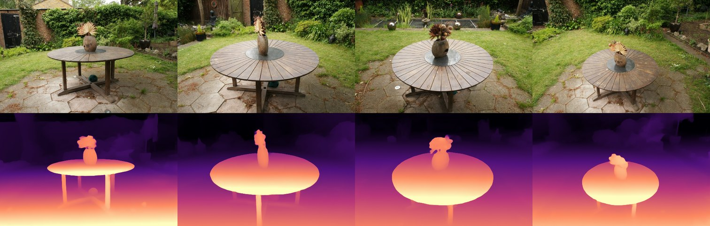

# Photos → Depth & Cameras in One Pass

[Depth Anything 3](https://github.com/ByteDance-Seed/Depth-Anything-3) (DA3)
is a feed-forward geometry model: give it any number of photos of a static
scene and **one forward pass** returns every view's depth map, confidence,
intrinsics and camera pose — the job classically done by
structure-from-motion, without feature matching or bundle adjustment.
`mlx3d.models.DepthAnything3` runs it natively on the Apple GPU.

<p align="center">
  
  <br/>
  <em>4 of 24 input views (top) and the depth DA3-Base predicts for them
  (bottom, bright = near) — all 24 views in 5 s on an M1 Pro.</em>
</p>

## Quick start

```bash
pip install "mlx3d[models]"   # adds huggingface_hub for the one-time weight download
```

```python
from mlx3d.models import DepthAnything3

model = DepthAnything3.from_pretrained("da3-base")   # downloaded once, then cached
pred = model.predict(["0.jpg", "1.jpg", "2.jpg"])   # paths, PIL images, or arrays

pred.depth            # (S, H, W) depth per view
pred.depth_conf       # (S, H, W) confidence (>= 1, higher is better)
pred.cameras()        # list[mlx3d.cameras.Camera], OpenCV convention
points, colors = pred.point_cloud()   # fused, confidence-filtered, colored
```

Inputs are resized so the longest side is 504 px (the training resolution)
and both sides are multiples of 14. The world frame is one of the input
cameras, at an arbitrary but consistent scale.

Or run the example end to end — it writes the depth strip above, a fused
`points.ply`, and a fly-through video:

```bash
python examples/predict_geometry.py path/to/photos --out outputs/da3
```

<p align="center">
  <video src="../../assets/da3_garden_flythrough.mp4" width="80%" autoplay loop muted playsinline controls></video>
  <br/>
  <em>The 24 depth maps fused into one point cloud through the predicted
  cameras, flown along the predicted trajectory (rendered as splats by
  <code>FastGaussianRenderer</code>).</em>
</p>

## What you get

| Field | Shape | Meaning |
|---|---|---|
| `depth`, `depth_conf` | `(S, H, W)` | z-depth and its confidence at processing size |
| `R`, `t` | `(S, 3, 3)`, `(S, 3)` | world-to-camera extrinsics |
| `K` | `(S, 3, 3)` | intrinsics (principal point at the image center) |
| `rgb` | `(S, H, W, 3)` | the resized frames the model saw |
| `ray`, `ray_conf` | `(S, h, w, 6)` | DA3's per-pixel ray maps (`with_rays=True`) |

Helpers turn these into mlx3d objects:

```python
cam = pred.camera(0, original_size=True)  # intrinsics rescaled to the input photo
xyz = pred.world_points(0)                # (H, W, 3) unprojected view 0
clouds = pred.to_pointclouds()            # mlx3d.structures.Pointclouds
```

## Long sequences

Every view attends to every other, so the cost of a single pass grows
quadratically with the number of views. Past `max_views` (32 by default),
`predict` switches to **anchored chunks**: a few evenly spaced anchor views
are included in every chunk, and each chunk is mapped into the first one's
frame by the similarity transform that best aligns its anchor cameras. Cost
then grows linearly, and since every chunk is tied to the same anchors,
errors do not accumulate along the sequence.

```python
pred = model.predict(frames, max_views=32, num_anchors=8)   # any number of frames
```

On the 24-view garden, chunks of 12 recover the single-pass cameras to within
2.5% of the scene extent (median) and 1.5° in rotation.

## As the pose engine for `mlx3d-capture`

Feed-forward poses are the [capture pipeline](capture.md)'s default pose
engine (`--poses auto` with the `models` extra). They do not
need texture or wide overlap to register a frame, so they succeed on sparse,
low-texture or blurry captures where SfM drops views; the trainer's joint
pose refinement then polishes them:

```bash
mlx3d-capture ./my_photos/                                # DA3-Base
mlx3d-capture walk.mp4 --pose-model da3-small             # ~2x faster pose stage
```

## Models

| Preset | Params | Weights license | 24 views @ 504×322, M1 Pro (fp32 / fp16) |
|---|---|---|---|
| `da3-small` | 34 M | Apache-2.0 | 2.4 s / 2.0 s |
| `da3-base` | 135 M | Apache-2.0 | 5.2 s / 4.2 s |
| `da3-large` | 411 M | CC BY-NC 4.0 (non-commercial) | — |

`from_pretrained(..., dtype=mx.float16)` runs the backbone in half
precision (the dense head and camera decoder stay in float32, as in the
reference implementation). Float16 tracks float32 closely — 0.03% median
depth difference and 0.01° in rotation on the garden views — while bfloat16's
shorter mantissa costs visibly more (up to 2.6° on `da3-small`), so prefer
float16.

## How it works

DA3 is a DINOv2 vision transformer whose later blocks alternate between
attention **within** each view and attention **across all views** — the
cross-view blocks are what let it reason about relative camera motion. A
learned camera token per view is decoded into a pose and field of view, and
a DPT decoder turns the patch tokens into a full-resolution depth map. The
MLX port keeps the official checkpoints unchanged: weights are converted on
load, with every tensor accounted for, and the network uses MLX's fused
attention and layer-norm kernels.

**Parity.** Fed identical pixels, the MLX port matches the official PyTorch
implementation to float32 rounding — about 1e-6 relative error on every
backbone tap, depth, confidence, ray map and camera — for both `da3-small` and
`da3-base`, including the multi-view reference-view reordering.
